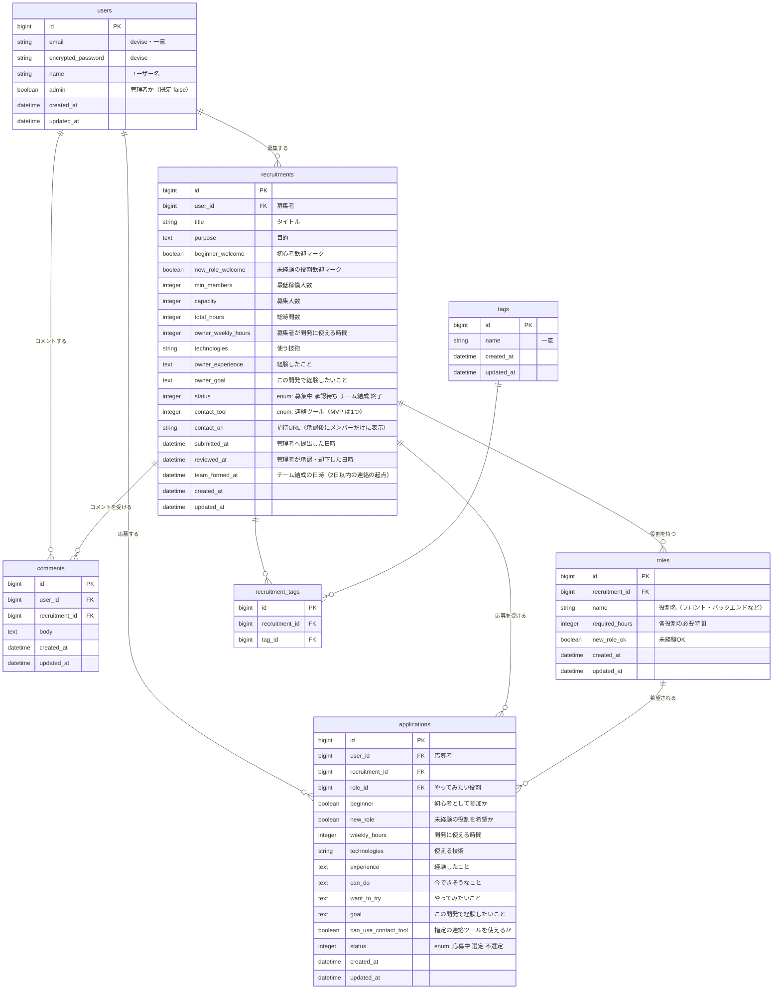

# ER 図

README の「7. このアプリで実現すること」と「10. 技術スタック」、画面遷移図（Figma）をもとにした、MVP のデータ設計です。

## テーブル詳細

どのテーブルにも、主キーの `id : bigint` と、作成・更新日時の `created_at` / `updated_at : datetime`（Rails が自動で入れる）があります。以下では省いています。外部キーは `相手のテーブル名（単数形）_id` の形です。

### users（ユーザー）
- name : string / ユーザーの表示名（必須）
- email : string / ログイン用メールアドレス（必須・ユニーク制約）
- encrypted_password : string / 暗号化したパスワード（devise が管理・必須）
- admin : boolean / 管理者かどうか（初期値 false）

### recruitments（募集）
- user_id : bigint / 募集者（users への外部キー・必須）
- title : string / 募集のタイトル（必須）
- purpose : text / 開発の目的（必須）
- beginner_welcome : boolean / 初心者歓迎マークを表示するか（初期値 false）
- new_role_welcome : boolean / 未経験の役割歓迎マークを表示するか（初期値 false）
- min_members : integer / 最低稼働人数（必須・1 以上）
- capacity : integer / 募集人数（必須・最低稼働人数以上）
- total_hours : integer / 開発の総時間数
- owner_weekly_hours : integer / 募集者が開発に使える時間（週あたり）
- technologies : string / 使う技術
- owner_experience : text / 募集者の経験したこと
- owner_goal : text / 募集者がこの開発で経験したいこと
- status : integer（enum） / 募集の状態。募集中 0 / 承認待ち 1 / チーム結成 2 / 終了 3（初期値 募集中）
- contact_tool : integer（enum） / 連絡ツールの種類（MVP では 1 つ。選べるツールは README の表のとおり）
- contact_url : string / 連絡ツールの招待 URL（承認後、チームメンバーだけに表示）
- submitted_at : datetime / 管理者へ提出した日時（未提出は空）
- reviewed_at : datetime / 管理者が承認・却下した日時（未確認は空）
- team_formed_at : datetime / チーム結成の日時（成立から 2 日以内の連絡の起点・結成前は空）

### roles（役割）
- recruitment_id : bigint / 所属する募集（recruitments への外部キー・必須）
- name : string / 役割名。フロント、バックエンドなど（必須）
- required_hours : integer / その役割に必要な時間
- new_role_ok : boolean / 未経験でも応募してよいか（初期値 false）

### applications（応募）
- user_id : bigint / 応募者（users への外部キー・必須）
- recruitment_id : bigint / 応募先の募集（recruitments への外部キー・必須）
- role_id : bigint / やってみたい役割（roles への外部キー・必須）
- beginner : boolean / 初心者として参加するか（初期値 false）
- new_role : boolean / 未経験の役割を希望するか（初期値 false）
- weekly_hours : integer / 開発に使える時間（週あたり）
- technologies : string / 使える技術
- experience : text / 経験したこと
- can_do : text / 今できそうなこと
- want_to_try : text / やってみたいこと
- goal : text / この開発で経験したいこと
- can_use_contact_tool : boolean / 指定の連絡ツールを使えるか（初期値 false）
- status : integer（enum） / 応募の状態。応募中 0 / 選定 1 / 不選定 2（初期値 応募中）
- ユニーク制約 : user_id と recruitment_id の組（同じ募集に二重応募できない）

### comments（コメント）
- user_id : bigint / コメントした人（users への外部キー・必須）
- recruitment_id : bigint / コメント先の募集（recruitments への外部キー・必須）
- body : text / コメント本文（必須）

### tags（タグ）
- name : string / タグ名（必須・ユニーク制約）

### recruitment_tags（募集とタグの中間テーブル）
- recruitment_id : bigint / 募集（recruitments への外部キー・必須）
- tag_id : bigint / タグ（tags への外部キー・必須）
- ユニーク制約 : recruitment_id と tag_id の組（同じタグを二重に付けない）

## 設計のポイント

- **チームメンバー**は専用のテーブルを作らず、`applications.status` が「選定」の応募者で表します。連絡先（`contact_url`）は、募集の状態が「チーム結成」のときに、この応募者と募集者だけに表示します（pundit で判定）。
- **募集の状態**は `recruitments.status` の enum で持ちます。「却下」は状態ではなく「募集中に戻す」操作なので、`reviewed_at` に日時だけを残します。
- **管理者**は `users.admin` の真偽値で表します。管理者の承認・却下ページは、この値で表示を切り替えます。
- **連絡ツール**は MVP では募集テーブルの `contact_tool`（enum）と `contact_url` で持ちます。本リリースで用途ごとに複数選べるようにするときに、ツールのマスタテーブルと中間テーブルへ分けます（README の比較どおり）。
- **画像**（募集の画像投稿）は Active Storage を使うため、ER 図には出していません。`active_storage_attachments` が `recruitments` を指します。
- **タグ**は、画面遷移図の「タグ管理ページ」に合わせて `tags` と中間テーブル `recruitment_tags` で持ちます。README が本リリース用に挙げている acts-as-taggable-on（使用技術のタグ付け）とは別物です。
- 応募は、同じ人が同じ募集に二重に応募できないよう、`applications` に `user_id` と `recruitment_id` の組の一意制約をつけます。
- `comments` は、画面遷移図のとおり募集詳細ページの中で扱います。投稿・編集・削除は、コメントを書いた本人だけができます。
